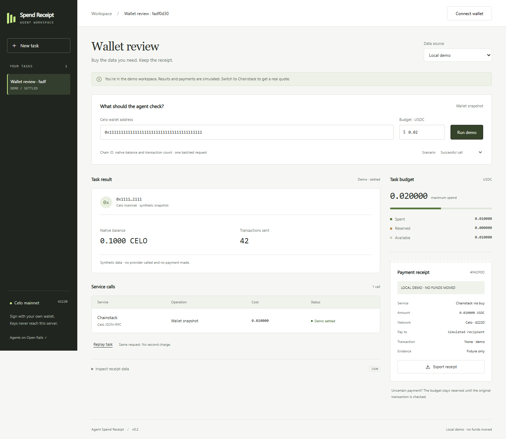

# Agent Spend Receipt

A Celo wallet-review workspace with a hard task budget and a receipt for each purchased service call. Built during Agents on Open Rails for **Build with buy**.

The v0.2 workspace replaces the earlier landing-page layout with task navigation, a wallet snapshot, a service-call ledger, and a separate payment inspector. The running default is safe for review: demo runs, real unpaid quotes and receipt exports work; mainnet execution is disabled until the owner enables it and a user explicitly signs in their own wallet.



## Run

Node.js 24+ is required.

```powershell
npm.cmd ci --ignore-scripts
npm.cmd test
npm.cmd run build
npm.cmd start
```

Open `http://127.0.0.1:4318`. Use **Local demo** for simulated results or **Chainstack · paid on Celo** to inspect a real unsigned 402 quote. No wallet is needed to view a quote. Connect an EOA wallet before preparing an actual purchase; its address must match the quoted payer.

```powershell
npm.cmd run probe
npm.cmd run test:ui
node scripts/ui-live-qa.mjs
npm.cmd run evidence:verify
npm.cmd run readiness
```

The first command performs read-only external probes. UI QA uses Playwright and installed Chrome on Windows; other platforms need a Playwright Chromium installation. `ui-live-qa` is a fully injected browser signing test with an ephemeral, never-funded account. It sends no payment to a real provider. Evidence is written to `evidence/` and `submission/assets/`.

## What it does

A Celo application operator can inspect a nominated wallet by batching chain ID, native CELO balance and sent-transaction count into one Chainstack request through buy. The result appears next to its cost, destination, authorization nonce and transfer evidence. These reads do not classify a wallet as safe, identify a human, determine source of funds or prove hackathon eligibility.

A free RPC can provide the same basic data. The value being tested is controlled service procurement and payment recovery, not a claim that these reads require payment. Real demand, saved time and willingness to pay have not yet been established with an independent user. No baseline costs, customers, savings or users have been invented.

## How a real purchase works

1. The server requests an unpaid HTTP 402 quote from the one allowlisted Chainstack buy endpoint, validates Celo mainnet USDC, and binds the request and atomic amount.
2. The user reviews the full payer, provider PayTo, token and amount. Before signature preparation, a fresh free quote must match the original requirement, and a public Celo RPC checks the payer's USDC balance.
3. The official `@celo/buy-core@0.8.3` SDK constructs the exact EIP-3009 authorization. SQLite reserves the task budget and persists the public nonce before the browser asks for a signature. No private key or signature is stored in SQLite.
4. The browser asks the user's EOA wallet to sign the typed data on Celo. The server recovers and checks that signature against the fixed original payload and approved payer. It changes the call state atomically before sending exactly one signed HTTP request. It does not use the old re-quoting CLI.
5. A response, rejection or timeout remains unresolved payment evidence. A separate HTTPS Celo RPC must observe the successful transaction, exact USDC payer/payee/amount, canonical block with at least three confirmations, and this task's `AuthorizationUsed` nonce before the payment is marked settled.

The SDK signs a token authorization, not the HTTP request body. This app links one persisted nonce to one immutable request. Transfer/nonce evidence still does not prove that the service returned useful data, and it cannot establish that a user is independent.

## Budget and recovery behavior

Amounts use six-decimal atomic USDC integers. A task's budget cannot be enlarged after creation. Request/quote hashes, unique task/request pairs and unique transaction hashes protect against duplicate accounting. Reservations commit before asynchronous provider work.

- Fixture success is explicitly labelled synthetic; no chain proof is attached.
- Unsigned preparation holds funds in `AWAITING_SIGNATURE`; cancellation releases them and makes submission impossible.
- A compare-and-set transition allows only one signed send. A process restart during sending becomes `UNKNOWN`.
- An uncertain signed request retains the full reservation. There is no automatic payment retry. Inspect the original transaction or provider receipt, then reconcile it.
- A verified transfer consumes the budget even when the purchased service failed to return a usable result.

This is deterministic task planning with real payment-protocol integration. No LLM/inference-provider execution is claimed. Supported scope: one Chainstack route, USDC on Celo mainnet, EOA signatures, single-process SQLite deployment. Split settlements, smart-contract-wallet signatures and account recovery are not implemented.

## Evidence and release state

Local tests cover the official SDK, real signature math with ephemeral test keys, duplicate/concurrent requests, signer mismatch, quote drift, balance refusal, nonce binding, restart recovery, identity calldata and session isolation. Browser checks cover the rendered workspace and an injected signing/reconciliation loop. A real external 402 quote and public Celo chain read have been observed.

**No real paid call, registered ERC-8004 identity, verified independent user, public project repository, hosted deployment, accepted registration or final submission is claimed.** These remain distinct release gates. See [submission readiness](submission/READINESS.md), [mainnet review](submission/MAINNET_REVIEW.md), [deployment](submission/DEPLOYMENT.md), and [official rules](submission/RULES.md).

Read-only evidence verification is documented in [submission/EVIDENCE.md](submission/EVIDENCE.md). The gate requires RPC-observed registry and payment checks bound to the current manifest; hand-written verified flags are not accepted as chain proof.

[Watch the 33.8-second captioned local product demo](submission/assets/product-demo-captioned.mp4). The recording shows simulated task outcomes and a real unsigned quote, with no real payment.
